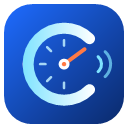

<p align="center"></p>

# Cyberdrome Simulator

**English** · [Svenska](README.sv.md)

Cyberdrome simulates an Android car radio with a virtual OBD port, so you can develop and test media, radio and OBD
apps without a real car. It runs Android Automotive, emulates car models with their own themes, trouble codes, coding
and GPS, and can also connect to a real OBD adapter.

- **Free software:** GPL-3.0-or-later (see [LICENSE](LICENSE)) – © 2026 Jouko Broström. No warranty, see the
  [disclaimer](legal/DISCLAIMER.md).
- **Support the development:** Cyberdrome is free and funded by donations – [donate via PayPal](https://www.paypal.me/stw78).
- **Contribute:** see [CONTRIBUTING.md](CONTRIBUTING.md).
- **Languages:** the program is available in English and Swedish (Settings → Language).

## Getting started (Windows + VS Code)

1. Get the code (`git clone`) and open the folder in VS Code (File → Open Folder). You need the .NET 10 SDK on Windows 10/11.
2. Install the **C# Dev Kit** extension if VS Code asks.
3. Press **F5** (or run `dotnet run --project src/Cyberdrome.App` in the terminal).
4. The first time, Windows Firewall asks whether the program may use the network. Answer **Yes (private network)**,
   otherwise no apps can connect to the virtual OBD port.

Run the tests: `dotnet test`

## Installation and release (version 1.0)

**Install:** run `CyberdromeSimulator-win-Setup.exe`. It installs per user in `%LocalAppData%\CyberdromeSimulator`,
without administrator rights, and creates shortcuts on the desktop and in the Start menu. The disclaimer is shown at
the first start. There is also `CyberdromeSimulator-win.msi`, which shows the GPL licence in the installer wizard. The
MSI installs for the whole computer and requires an administrator.

**Uninstall:** via Settings → Apps in Windows. The program then asks **"Do you also want to remove my data?"**.
The default answer is **No**. Your own car models, themes, skins, drives, test cases, backups and settings in
`%AppData%\Cyberdrome` are kept, and so are logs and cache in `%LocalAppData%\Cyberdrome`.

**The package contains** only our own files:
- the program with .NET (self-contained),
- the car models and the licence texts,
- our own Android apps (Cyberdrome Launcher and Cyberdrome Radio in `apps\`).

The following are downloaded by the user at runtime and are not included:
- the Android emulator and Google images,
- AndrOBD and Organic Maps,
- map tiles,
- vPIC, Wikidata and OBDb data.

**Updates:** Settings → Updates checks a local folder. By default this is `Desktop\Projekt\release\uppdateringar` if
`Desktop\Projekt` exists, otherwise `Documents\Cyberdrome\release\uppdateringar`. No server is used. "Install update"
downloads, closes the program, installs and starts it again. Your data is not affected.

**Building a release:** `powershell -ExecutionPolicy Bypass -File build-release.ps1 -Version 1.0.0`. The script:
- runs the tests and generates `legal\THIRD-PARTY-NOTICES.txt` from the NuGet packages (`tools\gen-notices.ps1`),
- publishes a self-contained win-x64 build and checks that no forbidden apps or files are included,
- packs it with Velopack (`vpk`, MIT).

The result goes to `..\release\<version>` next to the code folder: Setup.exe, MSI, portable zip and licences. The
update feed goes to `release\uppdateringar`. Flags: `-SkipTests`, `-NoMsi`. The logo is `assets\logo.svg`; the icons,
the .ico, the Android icons and `assets\social-preview.png` are generated by `tools\make-logo.ps1`.

**Code signing.** Without a signature, Windows SmartScreen warns ("Unknown publisher"). The build script can sign
everything (the program, our own DLLs, Setup.exe and the MSI) with a timestamp. The mode is chosen in `signing.json`
(template: `signing.example.json`; the file is never committed):
- `test`: a self-signed test certificate in your certificate store. It only tests the chain and is not trusted.
- `certificate`: your own purchased certificate (thumbprint, e.g. on a USB key) or a cloud signing command (`signTemplate`).
- `azure`: Azure Artifact Signing (`metadata.json`).

The plan for the open-source builds is **SignPath Foundation**, which signs open-source projects for free. It needs a
public GitHub repository and a build in GitHub Actions. The workflow is in `.github/workflows/build.yml`, with a
prepared signing step.

**Licences:** the **About** and **Licence** buttons in the top bar show the version, a description, the disclaimer,
the GPL-3.0 and the third-party licences.

## Try the virtual OBD port

The program starts a pretend Wi-Fi OBD dongle (ELM327) on port **35000**. The address is shown in the window, e.g.
`192.168.1.20:35000`.

- **Android phone on the same Wi-Fi:** open an OBD app (e.g. Car Scanner or Torque), choose *Wi-Fi adapter*, and enter
  the computer's address and port 35000.
- **From the computer:** `telnet 127.0.0.1 35000`, then type `ATZ`, `010D` (speed), `010C` (engine speed), `0902` (VIN).

Change speed, engine speed etc. with the sliders – the app sees the new values immediately. All traffic is shown under
**OBD log**.

## Features in version 1.0

| Part | Status |
|---|---|
| Virtual ELM327 over Wi-Fi (TCP 35000), Bluetooth and Bluetooth LE | Done |
| OBD 01/03/04/09, UDS 10/22/2E/27/3E, manufacturer signals (21/22) | Done |
| Android Automotive inside the program (no restart), themes and skins per car model | Done |
| Car models: own, sharing (.cbs), ODX/VSS/CSV, car database (vPIC, Wikidata, OBDb) | Done |
| Drives, map and GPS to Android | Done |
| Test cases with reports | Done |
| Real OBD adapter: read-only, bridge, write protection | Done (tested against a fake adapter) |
| Installer and updates (Velopack) | Done |
| English and Swedish user interface | Done |

## Folders

```
src/Cyberdrome.Core           Car values, car profiles, coding, car database, standard formats
src/Cyberdrome.Obd            The ELM327 emulator, TCP server, real adapter, test cases
src/Cyberdrome.Vm             Android (emulator and WSL2 + Cuttlefish), screen, skins, themes
src/Cyberdrome.App            The program window (Avalonia)
src/Cyberdrome.Localization   Texts: Strings.resx (English) and Strings.sv.resx (Swedish)
android/                      Our Android apps (Cyberdrome Launcher and Cyberdrome Radio)
tests/                        Automated tests (xUnit)
profiles/                     The car models (JSON)
assets/                       Logo (SVG) and images
legal/                        Disclaimer and third-party licences
```

## Adding a car model

Copy a file in `profiles/` and change `id`, the name and the VIN (17 characters). Each feature points to an ECU
(`ecu`) and to a byte and a bit in the ECU's coding. The coding is at most 4 bytes per ECU, so an ordinary ELM327 can
write it in one CAN frame. Do not add features that turn off safety warnings.

## Important

All car models, CAN ids and coding data are made-up examples for testing and do not correspond to real cars. The code
is free software under GPL-3.0-or-later. Third-party components and their licences are listed in
`legal\THIRD-PARTY-NOTICES.txt`.

## The Android screen inside the program (No restart mode)

The **Overview** page shows the live Android screen (via adb, about 5 frames/s). Click, drag (swipe) and hold directly
on the screen. Below the screen there are these buttons:
- **+ Install app** (APK).
- **Restart app** (the app in the foreground).
- **Take screenshot**. It is saved in `Desktop\Projekt\skarmbilder` if that folder exists, otherwise in
  `Documents\Cyberdrome\skarmbilder`.
- **Steering wheel buttons**: previous (88), next (87) and mute (164) as Android key events.

## Bluetooth OBD dongle ("OBDII")

The **Bluetooth (OBDII)** switch in the Virtual OBD card (Overview) starts a Bluetooth service with the Serial Port
Profile (SPP, UUID 00001101-…) called **OBDII**, just like an ELM327 Bluetooth dongle.
- Each connection gets its own ELM327 against the same virtual car as the Wi-Fi port.
- The traffic shows up in the OBD log as "Bluetooth: <device>".
- The choice is saved in `%AppData%\Cyberdrome\app.json` (off by default).
- It uses Windows' built-in Bluetooth (WinRT), with no extra packages.

**Android phone:** pair the phone with the computer in the phone's Bluetooth settings. Then choose Bluetooth adapter
in the OBD app and pick the computer in the list.

**iPhone** cannot use classic Bluetooth OBD (SPP); that is a limitation in iOS. Use the **Bluetooth LE (iPhone)**
switch instead. The computer then becomes a BLE OBD dongle like the Vgate iCar Pro BLE (service FFF0, FFF1 =
replies/notify, FFF2 = commands/write). No pairing in iOS is needed: choose adapter type Bluetooth LE in the OBD app
(e.g. Car Scanner) and pick the computer in the list. The Wi-Fi port also works.

## Car models: own and shared (.cbs)

**Built-in models** on the **Car models** page are **read-only**; there are six of them. **New car model from copy**
opens an editor for:
- make, model, generation, model year, id and VIN,
- trouble codes at start,
- the PIDs the car answers. Empty means all that the simulator supports; this also affects the support tables
  0100/0120/0140.
- start values, screen preset and theme,
- control units: key, name, CAN request/response id, coding (at most 4 bytes) and coding DID,
- hidden features: control unit, byte and bit.

**Saving:** everything is validated first. Your own models are stored in `%AppData%\Cyberdrome\bilar\` and marked
**(Own)** in the list. Only those can be edited and deleted.

**Export car model** creates a `.cbs` file (a zip) containing:
- `bilmodell.json`, optionally with the current coding,
- `tema/theme.json` if your own theme is selected,
- `skal/…` if your own skin is selected,
- `testfall/*.json` for your own test cases that belong to the model.

**Import car model** checks the file first. If the id clashes with a built-in or existing model, the import gets a
new id ("-2", "-3" …) and "(imported)" in the name; built-in models are never overwritten.

`.cbs` stands for *Cyberdrome System*. Older `.cyberbil` files (same content) can still be imported. Every `.cbs` also
contains a copy of the car model as ASAM ODX in `odx/<id>.odx-d`.

**Important:** shared files must not contain real manufacturers' seed/key algorithms or other protected information.
The security formulas in Cyberdrome (`securityAccess`) are made up and must stay that way.

## Standard formats

There is no single standard for a complete "car model file", so Cyberdrome uses the open or established formats that
cover the parts:

| Format | Standard | Used for | Button (Car models page) |
|---|---|---|---|
| `.pdx` / `.odx-d` | ASAM MCD-2D **ODX 2.2** (ISO 22901-1) | Control units, CAN ids, coding (UDS 22/2E + DID), trouble codes with texts | **Export ODX (.pdx)**, **Import car model** |
| `*.json` | COVESA **VSS** (Vehicle Signal Specification) | The car's values with standard names, e.g. `Vehicle.Speed` | **Export/Import values (VSS)** |
| `*.csv` | Torque / Car Scanner "custom PID" | Custom PIDs (e.g. mode 22) that the simulator answers | **Import/Export PIDs (CSV)** |
| `*.csv` | SAE J2012 style (`P0300;Text`) | Trouble code texts for the car model | **Trouble code texts (CSV)** |

**ODX:** Cyberdrome reads the part of ODX that the simulator can use.
- `BASE-VARIANT`/`ECU-VARIANT` become control units.
- `COMPARAM-REF` `CP_CanPhysReqId`/`CP_CanRespUSDTId` become CAN ids.
- Service 0x2E (or 0x22) with an `ID` parameter becomes the coding DID; the length comes from
  `DATA-OBJECT-PROP`/`BIT-LENGTH` (at most 4 bytes).
- `DTC-DOP` gives trouble codes and texts.

Everything that is not used is listed after the import ("Ignored"): flash data, jobs, functional groups, communication
specifications, 0x27 services (Cyberdrome has its own made-up formula) and other services.

The export writes ODX 2.2 with one `BASE-VARIANT` per control unit. Data that ODX has no place for (hidden features,
PID list, theme …) is stored in an `SDG` "Cyberdrome", so export followed by import loses nothing. Seed/key is never
exported. No manufacturer ODX files are included; the tests use a made-up example file.

**VSS:** signal names are `Vehicle.Speed` (0D), `Vehicle.Powertrain.CombustionEngine.Speed` (0C),
`…CombustionEngine.ECT` (05), `Vehicle.Powertrain.FuelSystem.RelativeLevel` (2F), `Vehicle.OBD.ThrottlePosition` (11),
`Vehicle.OBD.IntakeTemp` (0F), `Vehicle.Exterior.AirTemperature` (46), `Vehicle.LowVoltageBattery.CurrentVoltage` (42),
`Vehicle.Powertrain.Transmission.SelectedGear`, `Vehicle.LowVoltageSystemState`, `Vehicle.OBD.DTCList` and
`Vehicle.VehicleIdentification.*`. The file is flat JSON (`{"Vehicle.Speed": 54}`); `{"value": 54}` also works.

**Torque/Car Scanner CSV:** the columns are `Name,ShortName,ModeAndPID,Equation,Min Value,Max Value,Units,Header`.
- The simulator answers imported PIDs. If a header is given, only that control unit answers.
- It works backwards from the formula: `A`, `A*k`, `A/k`, `A+k`, `A-k`, `A*256+B`, `(A*256+B)/k`, `A*100/255`.
- The same file can be loaded into the app on the phone.
- The export includes the coding DIDs of all control units.

**DBC** (CAN messages) is not included yet. It only becomes relevant if Cyberdrome simulates raw CAN traffic.

## Real OBD adapter (OBD source page)

Cyberdrome can connect to a real car through an **ELM327-compatible** adapter (ELM327, OBDLink/STN, vLinker, Vgate and
others):

| Connection | How |
|---|---|
| USB or Bluetooth via COM port | Choose the COM port and speed (usually 38400). Paired classic Bluetooth adapters get a COM port in Windows. |
| Bluetooth (paired) | Classic Bluetooth (SPP) directly. Pair the adapter in Windows first (code often 1234 or 0000). |
| Bluetooth LE | The services FFF0 (FFF1/FFF2), FFE0 (FFE1), 18F0 (2AF0/2AF1, e.g. vLinker) and OBDLink CX are recognised; otherwise the first service with notify + write is used. |
| Wi-Fi | Connect the computer to the adapter's Wi-Fi and enter the address (usually 192.168.0.10:35000). |

- **Identify adapter** connects, lists the BLE services and tries `ATZ`, `ATI`, `ATE0` and `0100`. Everything shows up
  in the OBD log, and the result tells whether the adapter is ELM327-compatible. Adapters locked to a manufacturer's
  app (that do not answer ELM327) get "The adapter is not supported (locked to the manufacturer's app)". Their
  protocol is not analysed.
- **Connect** puts the adapter in a known state (`ATE0 ATL0 ATS1 ATH1 ATSP0`). It shows the version (`ATI`, `STI`),
  protocol and voltage (`ATRV`). The adapter's stored settings (`ATPP`) are never changed.
- **Read real car** reads these things, using only read services:
  - supported PIDs (0100/0120/…),
  - VIN (0902) and calibration ids (0904),
  - trouble codes (03) and live values,
  - which control units answer (7DF, 7E0–7E7 and common UDS addresses with `22 F190`).
- **Create virtual car from real car** makes your own car model from the reading (control units, PIDs, trouble codes,
  start values). **Hide VIN serial number** (on by default) replaces the last six characters of the VIN with 000001,
  so the file can be shared.
- **Real adapter (bridge apps to the car)**: the apps in Android and on the phone (Wi-Fi port 35000, Bluetooth, BLE)
  talk to the real car through the adapter. AT commands from the app are handled by Cyberdrome; everything shows up in
  the OBD log.

**Safety (read-only by default).** The write filter blocks everything that could change something in the car:
- `04` (clear trouble codes),
- UDS `2E`, `2F`, `31`, `34`–`37`, `3B`, `3D`, `11`, `14`, `27`, `28` and `85`,
- `10` with anything other than `01`,
- all unknown services.

The app then gets a negative reply (`7F xx 22`) and the OBD log shows why. With **Allow writing for this session**
(reset when the adapter is disconnected) these rules apply:

1. The voltage is checked (`ATRV`). Below 12.0 V the write is blocked.
2. The original value is read and saved first in `%AppData%\Cyberdrome\backup` (`2E` → `22` same DID, `3B` → `21`,
   `04`/`14` → the trouble codes).
3. A dialog shows the control unit, service, data, voltage and the backup. Nothing is sent without **Write to the car**.

Cyberdrome never computes manufacturers' seed/key algorithms. `27` is only let through when writing is allowed, and
the key must come from the app.

## Car database (Car database page)

The car database is a local SQLite file, `%AppData%\Cyberdrome\bildatabas.db`, that the program connects to. You fill
it from open sources by pressing the buttons yourself. Nothing is included in the installation, and what has been
downloaded works without internet. The program uses the `IBilDatabas` interface, so the database can later move to a
Cyberdrome server.

| Source | Content | Terms |
|---|---|---|
| [NHTSA vPIC](https://vpic.nhtsa.dot.gov/api/) | Makes, models per model year, VIN decoding (mostly cars sold in the US, model year 1981–) | Open data, free to use, no registration |
| [Wikidata](https://www.wikidata.org) | Model names per manufacturer, also for European cars (e.g. Saab 9000, Volvo 240), years where available | CC0: free to use |
| [OBDb](https://github.com/OBDb) | Manufacturer signals per model (mode 21/22: control unit, request, bit position, formula, unit) | **CC BY-SA 4.0**: the source must be credited, and modified data is shared under the same licence |

- **Search**: make/model (all words must match) and optionally year. The results merge the sources; ★ means OBDb has
  manufacturer signals.
- **Decode VIN**: vPIC. The result is saved in the database, so the same VIN then works without internet.
- **Get makes / models (vPIC)**: per make and year range. Years already downloaded are not fetched again.
- **Get models (Wikidata)**: all car models for the make (Volvo and Saab are preset, other makes are looked up). The
  answer is cached for 30 days. Wikidata often lacks model years. In that case, enter the year in the **Year** field
  before pressing **Create car model**.
- **Get vehicle list (OBDb)**: about 800 vehicles. A model's signal file is downloaded when you choose it. It is stored
  as a separate data pack in `%AppData%\Cyberdrome\obdb` (with `LICENS.txt`) and never mixed into the program code.
- **Create car model**: makes your own car model with standard PIDs and OBDb's manufacturer signals, which the simulator
  answers.
  - Only requests that apply to the model year are included, and requests with extended addressing are skipped.
  - Control units are added per CAN id.
  - Screen, theme and skin come from the closest built-in model (same make, otherwise Golf 8).
  - The model's source is stored in the `attribution` field.
- If OBDb's file for the model is missing or empty, the make's common signals are used (e.g. the `Volvo` repository).
  If there are no signals at all, the car model gets standard PIDs. Today this is the case for Saab 9-3 and 9-5, whose
  OBDb repositories are still empty.
- **OBD-II applies in the US from 1996, EU petrol cars from 2001 and EU diesels from 2004.** Older model years get a
  warning, and models before 1996 are saved as 1996.
- **Create standard OBD car** (when the model is not in any source): enter make, model and year. The car model gets
  standard OBD-II (PIDs, VIN, trouble codes). Add manufacturer signals later on the **Car models** page:
  - **Import PIDs (CSV)** (Torque/Car Scanner), or
  - **Import signals (OBDb JSON)** (format `signalsets/v3`).

  A request to the same control unit is replaced; other requests are kept.
- Car models of makes without a built-in model get a made-up VIN with the correct manufacturer code and model year
  (e.g. Saab 2008 → `YS3ZZZ00080000001`).
- Sources that are **not** used: manufacturers' workshop software (e.g. Volvo VIDA, Saab Tech2/WIS), databases derived
  from them, and forums. Their content is protected by copyright.

**Network:** vPIC and GitHub are queried with a pause between calls. On errors 429/5xx the request is retried after a
wait. If GitHub's request limit is reached, the program says when to try again; saved data keeps working.

**Checking from inside Android:** Cyberdrome Launcher has a developer tool that sends OBD commands from inside Android
and writes the replies to logcat:

```
adb shell "am broadcast -n se.cyberdrome.launcher/.ObdProbeReceiver -a se.cyberdrome.launcher.PROBE --es cmds 'ATZ;ATE0;ATSH700;221002'"
adb logcat -d -s CyberdromeProbe:I
```

## Test cases (pass/fail)

The **Test cases** page runs a test case while an app is connected to the virtual OBD (in Android, or a phone via
Wi-Fi/Bluetooth).
- Cyberdrome performs the steps (changes values, turns trouble codes on/off) and then checks the OBD traffic.
- The result is shown per check with excerpts from the log, and saved as **HTML + JSON** in
  `%AppData%\Cyberdrome\testresultat\`.
- Built-in test cases: **Basic PIDs**, **Trouble codes: read and clear** and **Coding via UDS 22**.
- Your own test cases are imported (JSON) and stored in `%AppData%\Cyberdrome\testfall\`. "Export as template" gives
  you a file to start from.

```json
{ "id": "my-test", "name": "My test", "description": "…", "profile": "vw-golf8", "drive": "Stadskörning 5 min",
  "values": { "speed": 50, "rpm": 2000, "coolant": 88, "fuel": 60, "ignition": true }, "durationSeconds": 30,
  "steps": [ { "at": 5, "action": "addDtc", "dtc": "P0300", "text": "Read trouble codes in the app" },
             { "at": 10, "action": "set", "values": { "speed": 90 } } ],
  "checks": [ { "type": "requestRate", "name": "Speed often", "command": "010D", "maxGapSeconds": 2 },
              { "type": "responseContains", "name": "P0300 visible", "command": "03", "text": "0300", "afterStep": 0 },
              { "type": "requestSeen", "name": "Clears", "command": "04", "optional": true },
              { "type": "noErrors", "name": "No error replies" } ] }
```

**Steps:** `set`, `addDtc`, `removeDtc`, `clearDtcs`, `note`.

**Checks:**
- `requestRate`: at least one request per N s. `010D` also matches several PIDs in the same request.
- `requestSeen`.
- `responseContains`: spaces and headers are ignored.
- `noErrors`: no `?` or `NO DATA` on OBD requests. AT/ST probes do not count.

`optional` gives "Not performed" instead of "Failed". **Quick picks for common trouble codes** (P0300, P0420 and
others) are on Overview.

## Look per car model: theme in Android and skin around the screen

**Theme** is the home screen inside Android, our own app **Cyberdrome Launcher** (`android\CyberdromeLauncher`). Each
car model has its own theme that imitates the brand's system: layout, colours, tiles and style. **Everything is drawn
by us: no logos, brand fonts, icons or manufacturer graphics** (only Android's own Roboto variants). Vehicle data on
the home screen comes only from OBD.

| Car | Layout | Screen |
|---|---|---|
| Golf 8 | grid with widget tiles, blue accent | 10" 1560×700 |
| Octavia 4 | grid, green accent, rounder tiles | 10" 1280×800 |
| 3 Series G20 | narrow menu on the left, wide tiles in a row | 12.3" 1920×720 |
| XC60 | portrait, four stacked tiles, climate row | 9" 768×1024 portrait |
| RAV4 | split home screen, blue/white button row | 8" 800×480 |
| Focus Mk4 | three large panels + tab row with one colour per tab | 8" 800×480 |

**Switching car model** automatically switches the **theme, screen format and skin**. The choices can be changed per
car model (Overview or Settings → Look): the car's own (default), another built-in one, your own, or off (Android's
normal home screen).
- The launcher is built and installed automatically when needed, and set as home screen
  (`cmd package set-home-activity`).
- The theme is sent with `am broadcast -n se.cyberdrome.launcher/.ThemeReceiver`.

**Your own theme** (Upload your own theme … – zip or theme.json) is stored in `%AppData%\Cyberdrome\teman\`:
```json
{ "id": "my-theme", "name": "My theme", "layout": "tiles | leftmenu | portrait | split | tabs",
  "colors": { "background": "#0B0F17", "surface": "#1A2333", "accent": "#3BA7FF", "text": "#FFFFFF", "muted": "#8FA3BF" },
  "cornerRadius": 14, "font": "sans | light | condensed | medium", "wallpaper": "gradient | lines | dots | plain",
  "tabColors": ["#F28C28","#E5484D","#F5C518","#3DBE6B","#9B6CF2","#8E8E93"], "screenPreset": "10in-1280x800" }
```

**Skin** is the frame/dashboard around the screen in Cyberdrome. Its buttons and knobs send Android keys: home 3,
back 4, volume 24/25, mute 164, play/pause 85, next 87, previous 88.

**Your own skin** (Upload your own skin …) is stored in `%AppData%\Cyberdrome\skal\<id>\`. It is either:
- a **PNG where the screen area is transparent** (the screen area is found automatically), or
- a zip/folder with an image + `skin.json`:
```json
{ "id": "my-frame", "name": "My frame", "width": 1600, "height": 900, "image": "frame.png",
  "screen": { "x": 300, "y": 120, "w": 1000, "h": 625 }, "screenPreset": "10in-1280x800", "orientation": "Landscape",
  "buttons": [ { "name": "Home", "label": "⌂", "rect": { "x": 700, "y": 790, "w": 200, "h": 60 }, "keyCode": 3 } ] }
```
The screen area and all buttons must be inside the image. Only use images you have the rights to.

## Screen size (Settings → Screen, and quick pick on Overview)

**Presets:**
- **10.1" 1280×800 160 dpi (default)** and 10.1" 1024×600,
- 7" 1024×600 170 dpi and 7" 800×480 133 dpi,
- 9" 1280×720 and 12.3" 1920×720,
- 10.4" Tesla style 1920×1200 / 1920×1080 213 dpi,
- **Custom**.

**Orientation:** every preset can be **landscape or portrait** (width and height are swapped). The change happens
directly in the emulator with `wm size` / `wm density` (the rotation is locked). It is saved in the AVD's `config.ini`
for the next cold start.

**Display:** the Android screen in Cyberdrome keeps the right proportions (black borders), and clicks are mapped to the
right pixel. Note that Android Automotive's own system menu is built for landscape screens and looks cramped in
portrait.

## Drives (record / play back)

The **Drives** page records the car's values (every 100 ms) while you move the sliders. It can also play back a saved
drive at 1×/2×/5×, with loop, pause and timeline. During playback the sliders are locked and follow the drive.

**Storage:** drives are saved as JSON in `%AppData%\Cyberdrome\korningar\`, and they can be exported and imported.

**Built-in examples** (our own generated data, the same every time):
- **Stadskörning 5 min** (city drive, central Stockholm),
- **Motorväg 10 min** (motorway, E4 north of Stockholm),
- **Kallstart** (cold start, parked, coolant 5 → 90 °C).

## Map and GPS

The **Map** page shows the car on a map (OpenStreetMap tiles, our own map control).
- Click to move the car, or click out a route and press **Drive the route**. The car follows the route at the speed
  from the slider or the drive.
- Drives store latitude/longitude per point.
- Every second the position is sent to the Android emulator with
  `adb emu geo fix <lon> <lat> <altitude> <satellites> <speed in knots>`. Android's GPS speed is therefore the same as
  the OBD speed; Android computes the heading itself.
- Location services in the emulator are turned on automatically.

**Map tiles:** the default is OpenStreetMap's own tiles, which may only be used moderately under their rules. The
address can be changed on the Map page (`MapTileUrl` in `%AppData%\Cyberdrome\app.json`). **Heavier use requires a
commercial or self-hosted tile server.** Tiles are cached in `%LocalAppData%\Cyberdrome\tiles`.
Map data © OpenStreetMap contributors (ODbL).

**Map app in Android:** the **Install map app (Organic Maps)** button downloads Organic Maps (Apache-2.0) from F-Droid
when you press it; it is not included with Cyberdrome. Organic Maps downloads the map for the area itself.

## Example app: Cyberdrome Radio (android\CyberdromeRadio)

Our own Android Automotive app, a template for radio/media software. It is our own code with no third-party
libraries.
- **Stations:** made-up stations (Neon FM, Radio Puls, Stadsradion, Kustradio, Retro 80). The audio is our own tones
  generated in the app (AudioTrack), with no stream and no copyrighted audio.
- **Steering wheel buttons:** `MediaSession` + `MediaBrowserService`. Next/previous switch station, and play/pause
  works.
- **Live OBD via ELM327 over Wi-Fi:** default `10.0.2.2:35000` (can be changed in the app). It reads speed (010D) and
  engine speed (010C) about twice a second and reconnects by itself.
- **Speed-dependent volume:** +1 step per 30 km/h, at most +5. It can be turned off.
- **Languages:** English and Swedish texts (`res/values`, `res/values-sv`), chosen by the phone's language.

**Building without Gradle:** `powershell -ExecutionPolicy Bypass -File android\CyberdromeRadio\build.ps1` (or the
VS Code task *build radio*). The result is `android\CyberdromeRadio\bin\CyberdromeRadio.apk`. The **Install
Cyberdrome Radio** button in Cyberdrome builds the app when needed and installs it in the emulator. This requires
`platforms;android-34` and `build-tools;34.0.0` in the SDK. The app is signed with a local debug key
(`%LocalAppData%\Cyberdrome\debug.keystore`).

## OBD test app: AndrOBD

The **Install test app (AndrOBD)** button (Overview and the Android page) does the following:
- downloads the latest AndrOBD from F-Droid (`com.fr3ts0n.ecu.gui.androbd`),
- checks that the file is a valid APK and saves it in `%LocalAppData%\Cyberdrome\apps\`,
- installs it in the emulator (`adb install -r -g`).

In AndrOBD, connect with connection type **Network**, IP **10.0.2.2** and port **35000**.

**Licence:** AndrOBD is open source under GPLv3. It is downloaded from F-Droid when the user presses the button and
is **not included with Cyberdrome**.

## Security key (UDS 0x27) in the simulated control units

**Unlocking:** coding with `2E` requires the extended session (`10 03`) **and** unlocking. `27 01` gives a seed
(4 bytes), and `27 02 <key>` unlocks (`67 02`).

**Replies:**
- A wrong key gives `7F 27 35`.
- After 3 wrong keys: `7F 27 36` and a 10-second lock (`7F 27 37`).
- A locked write gives `7F 2E 33`.
- `10 01` or `ATZ` locks again.

The OBD log shows the expected key after each seed, so you can test your own app.

**The formula** is in the car profile (`"securityAccess": { "xorMask", "rotateLeft", "add" }`, also per control unit):
`key = rotl(seed XOR xorMask, rotateLeft) + add`. **It is made up** for the simulation and does not correspond to any
real manufacturer's algorithm. The **Require security key (UDS 27)** switch on the Hidden features page turns the
requirement off for tests.

## Android mode (Settings)

Under **Settings** you choose how Android runs. The choice is saved in `%AppData%\Cyberdrome\android.json` (field
`Mode`).

- **No restart (Google's emulator, for development)** is the default. It uses the Android emulator in
  `C:\CyberdromeSDK` (field `SdkRoot`) with Windows Hypervisor Platform, and no restart is needed. Install Android does
  three things:
  - downloads the Android Automotive image (`SystemImage`) with a progress bar,
  - creates the virtual car,
  - starts it directly.

  Apps inside the emulator reach the virtual OBD port at **10.0.2.2:35000**. **Note:** Google's emulator images are
  downloaded by the user and must not be redistributed with Cyberdrome.
- **Fast – WSL2 + Cuttlefish (real AOSP)** is described below. It requires a restart the first time if Virtual Machine
  Platform is not turned on; the program asks first (Continue/Cancel).

## Android in Fast mode (WSL2 + Cuttlefish)

The **Android** page in the program does everything in order:
1. Turns on WSL2 if it is missing. The program explains first, then Windows asks for administrator permission, then
   the computer restarts.
2. Creates its own Linux environment, `Cyberdrome-Android`, which does not touch other Linux on the computer.
3. Installs Cuttlefish and downloads Android Automotive (several GB).
4. Starts Android. The screen is shown in the browser at https://localhost:8443.

Settings (e.g. which Android build to fetch, number of CPUs and memory) are in `%AppData%\Cyberdrome\android.json`.
Google's ready-made Cuttlefish build is downloaded by the user and is not redistributed with Cyberdrome.

If Windows **Smart App Control** is on, newly built files are blocked. Turn it off on the development computer.
